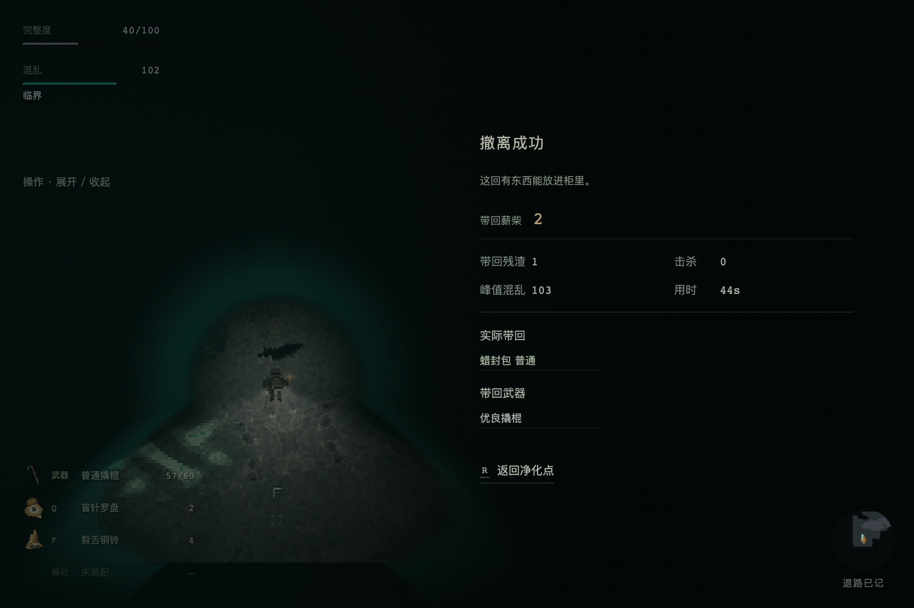

# 正常视野手玩：探路／声诱重度出行

固定一次 ash-strata / severe / 20261004，冻结3072。43.64秒真实模拟后成功撤离：2薪柴、普通蜡封包、优良撬棍，40HP、103.14混乱、0击杀；用了1次罗盘、1次铜铃，普通撬棍消耗3耐久。没有取得深堆，不是高回报通过。

[逐输入记录](inputs.jsonl)与[范围及结论](review.json)保留。进场后的决定仅依正常画面与公开读数；不读隐藏路线、敌人状态或掉落。装备为明确受控普通成熟配装，走真实准备UI；不是自然供给。

看图时暂停，因此不是实时反应能力测试。声诱在追逐发生后才投，攻击有朝向与时机错误；不能把此局失败于深搜直接当作熟练玩家的能力上限。100混乱后确实仍能承担代价撤回。前一次其他配装在同seed正常看图的路线经验存在，不称初见盲玩。未继续执行返家维护，结算画面的带回不能扩写为维护后利润。
