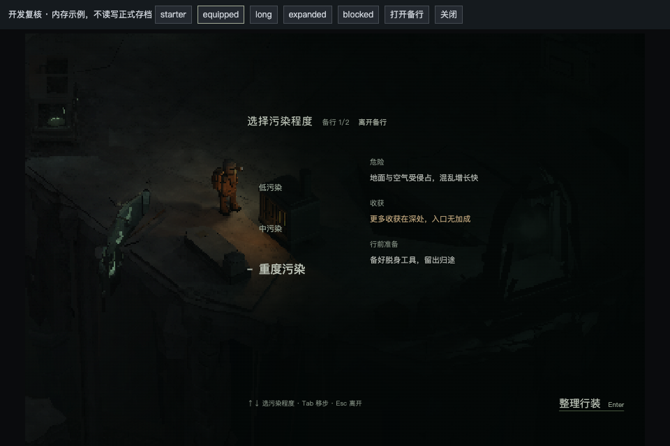
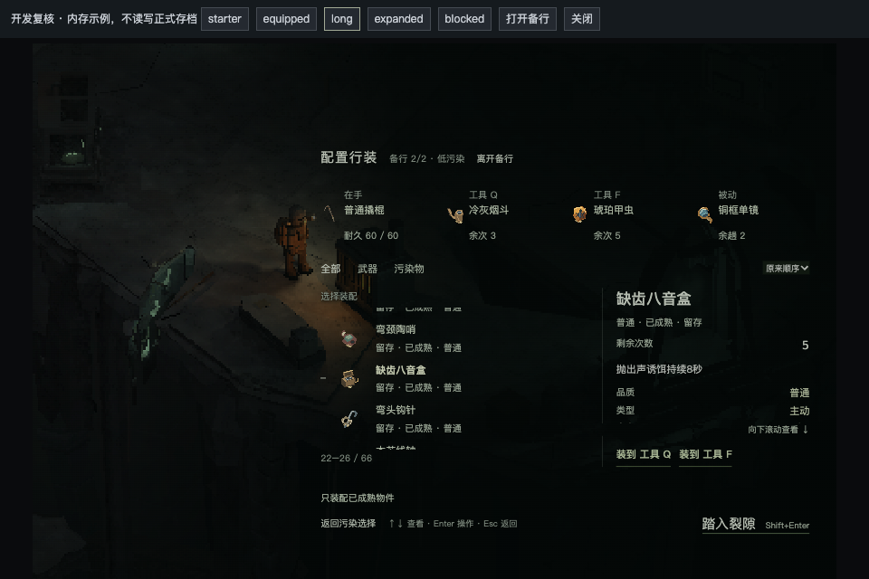

# 裂隙备行：先选污染，再整理行装

用户在体验`f9eea773`后再次指出：污染选择和行装同屏仍然拥挤，应先选择污染等级，再配置行装；物品列表要与净化点背包一致，否决双列；透明控件须通过文字编排突出重点。这是明确整改，上一轮视觉未获认可。P49保持open，I14未结案。

## 当前合同与范围

权威规格原地维护于[统一库存第5节](../specs/system-field-inventory.md#5-入口备行与装备hud)，视觉归[项目UI Kit](../design-notes/ui-art-overhaul.md)。严格两个环节：污染选择只提供选择/说明/下一步；行装配置提供单列库存、详情、实际挂位、已选档摘要与出发。没有第三确认，不改污染数值、装备规则、出发或保存事务。

第一环节无出发入口，Shift+Enter不能跳过配置；第二环节鼠标及Shift+Enter走原出发。返回保留污染与实际装配，列表选择及滚动继续使用共享库存的交互。字级、明度、间距和对齐建立当前决策/说明/操作的主次，不用全面提亮或新装饰代替层级。

## 实际验证

[专测最终报告](artifacts/preparation-flow-2026-10-09/run-02/report.json)8/8通过，Chrome155 / Apple M4 Pro ANGLE Metal，960×640测试视口；源码运行前后恒定。[QA汇总](artifacts/preparation-flow-2026-10-09/qa-summary.json)记录实际范围与脚本/源码绑定。

- 第一环节无行装、列表、详情或出发停点；选档不自动前进，Shift+Enter既不出发也不跳页。缺武器仍可正常进入配置；第二步才显示真实缺口并阻止出发。
- 低/中/重均经过配置后真实出发一次，写入对应等级；鼠标和Shift+Enter覆盖，普通Enter/Space及重复按键不误出发。第二步Esc返回选级、第一步Esc离开；显式离开直接关闭，镜头与输入恢复。
- 4/5挂位、空工具、单件/长库、长详情、未知公开投影覆盖。真实换装后列表1044px位置保持；两步往返保留装备、选择、筛选、排序及独立列表660px/详情82px滚动。当前库存可见区18–22的计数实际核对。
- 正式`Tab → 存续报告 → 物件`打开后，与备行执行同一单列行为对照：48px行高、点击/焦点选中、不因悬停改选、↑↓逐件、左右不动、Page±6、Home/End、仅键盘显露当前项；850px滚轮不会被旧焦点拉回。共享`check-inventory-view.mjs`回归通过，包含装配回滚、重复输入、图鉴导航及裂隙交换/退出/移动转发。
- 8个独立DEV上下文全页存储隔离，原生Storage调用0、哨兵值保持，用户浏览器记录未接触。DEV授予物件不计自然经营体验。

[首行为轮](artifacts/preparation-flow-2026-10-09/run-01/report.json)7/8原件保留：长库末段的零持续Tab测试未打开真实报告，未保存内部按键瞬态，不能据此认定引擎根因。生产源未变，仅将该次按键持时设为已有正式测试的70ms后执行唯一复验，真实报告对照通过。没有追加无界追测。

[最终构建](artifacts/preparation-flow-2026-10-09/build.json)TypeScript/Vite通过，保留既有大chunk提示；[来源差异](artifacts/preparation-flow-2026-10-09/source-delta.json)确认本轮只改panel和prepare局部样式，presenter、DEV隔离、领域、生成及存档代码不变。旧RC及其冻结来源文件哈希不变。

上一轮旧report脚本在直接消费后的完整world校验失败这一缺口仍保留，见[上轮QA](preparation-ui-2026-10-09.md)。本轮只同步该脚本的备行入口，没有重跑已知失败后段，不冒称已修；上述共享view与实际三档出发各自有独立证据。

## 文字与实景

[Art最终核对](artifacts/preparation-flow-2026-10-09/art-review.md)以[最终六对实帧](artifacts/preparation-flow-2026-10-09/frames-02/capture.json)检查三档选级、四/五挂位和长库。当前档/当前物18px与500字重，页题/主推进16px，正文12px、标签11px、键提示10px；选中列表和可执行装配采用500字重，仅局部强调，不把整屏加粗。

同一冻结世界帧保留backdrop，仅隐藏文字panel取得匹配背景，再立即恢复。按实际文字矩形/短划范围逐像素求最不利背景对比，[最终量化](artifacts/preparation-flow-2026-10-09/contrast-analysis-02.json)29项文本最低5.837:1、6项短划最低5.999:1，均超过各自4.5:1/3:1下限；2个实际disabled动作单列，不当有效操作计入。此为指定稳定帧的局部测量，不是所有相机/背景穷举、眼动或用户审美通过。分析工具随证据保留。

Root另在Codex内浏览器实际选重档→配置→选琥珀甲虫→返回选级，等级与阶段行为一致；完成后刷新预览至第一环节。这组操作不额外计自然出击。

## 体验入口与验收边界

正式入口：根游戏→净化点裂隙E。隔离入口：`http://127.0.0.1:3027/prepare-review.html?fixture=equipped`，复用生产组件和真实场景，页内存储隔离。用户审美与最终体验仍待复看；旧RC、48连续趟、较弱设备豁免各保持原边界。
