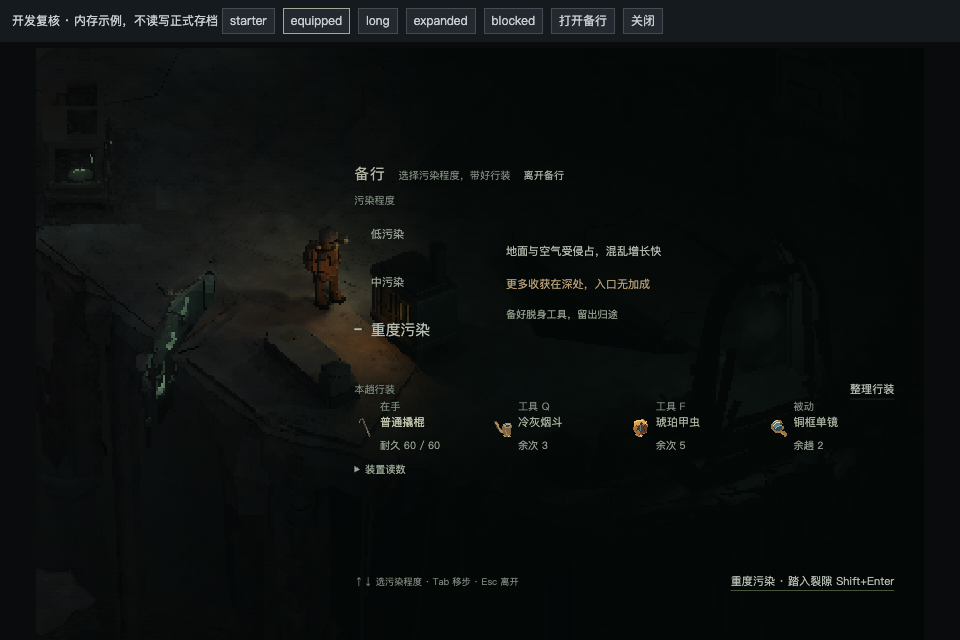
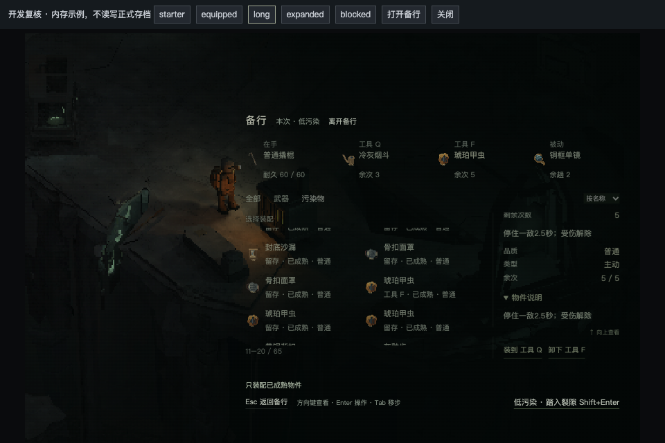

# 裂隙备行：污染选择与行装信息重构

用户在实际游戏中指出“加入污染等级选择后东西多布局乱”“污染等级选择的 ui 太糙太直白”，要求重构交互和信息呈现。[原始截图](artifacts/preparation-ui-2026-10-09/user-before.png)保留。该反馈是明确整改，不是新界面验收；I14仍未结案。

## 处理范围

唯一机制/UI规格原地维护于[统一库存第5节](../specs/system-field-inventory.md#5-入口备行与装备hud)，视觉随[当前Kit](../design-notes/ui-art-overhaul.md)更新。主F003，关联F023/F038/F052；仅备行信息层级、选择及返回操作、对应隔离预览入口。正式净化点与裂隙实体、三档数值、物品规则、出发/保存事务不改。

默认打开备行总览：污染选择为主，当前档的危险与深处机会就近阅读，行装以紧凑摘要呈现；要换装时进入同页整理状态。基地的真实出击条件按需展开。保留鼠标出发和Shift+Enter直接出发，不增入场门槛或确认流程。普通Enter不触发出发；整理Esc返回总览，总览Esc离开，显式离开按钮始终直接退出。

## 实际验证

[专测第二轮](artifacts/preparation-ui-2026-10-09/preparation-run-02/report.json)8/8通过，Chrome155 / Apple M4 Pro / Metal、960×640浏览器视口。使用真实净化点和正式组件，初始、齐装、五挂位、66件长库、无有效武器，以及低/中/重实际进入Rift均覆盖。DEV授予物件不计自然经营或长时体验证据。

- 选级鼠标/键盘一致，悬停不改档；普通Enter/Space不误出发；低档总览鼠标、中档整理Shift+Enter、重档总览Shift+Enter分别真实出发，各一次提交并冻结正确等级。整理不强制，切页不消费行装或预抽世界。
- 五挂位与空槽定位、两列方向键、长详情、真实无武器原因、固定装配/出发动作通过。装置读数展开不改变底栏位置。
- 仅用滚轮滚850再返回整理，未被旧选中项拉回；列表298/详情57的局部滚动亦保持。双列计数包含实际露出的半行，旧单列/过早布局计算问题已修。
- 退出跟踪在页面focused/未hidden条件下记录相机、Tween、场景时间与输入；最终zoom1/scroll0、inputEnabled=true。原第一轮260ms仍在zoom1.108，旧采样未包含Tween进度，保留为不足以证明恢复完成的失败窗口，不伪造根因。第二轮以生产Tween完成作为终态，未为此修改正式场景。
- 最终DEV在module导入前将全页Storage接口接至内存；游戏包、备份、旁白、语言等5个原生Storage哨兵原值保持、原生Storage调用为0。第一版仅SaveManager内存化，旁白/语言仍访问原生Storage，已修，首轮原记录保留。

[首轮失败原件](artifacts/preparation-ui-2026-10-09/preparation-run-01/report.json)与当时测试脚本/画面不覆盖；相机在入场Tween期间取样的问题仅修测试同步。[QA汇总](artifacts/preparation-ui-2026-10-09/qa-summary.json)绑定最终源码与测试脚本SHA，保留全部失败轮次。

共享`check-inventory-view.mjs`最终通过：60件库存、装配失败回滚、长按Enter单事务、重复Shift+Enter单出发、图鉴丢弃/导航，以及裂隙交换、Esc与移动转发。旧`check-inventory-report.mjs`整体仍失败：真实图鉴、供奉导航、备行整理、长详情、固定底栏与初始四槽裂隙HUD通过；随后测试直接调用`consumeTool`，开放frame内返回成功/余次5，但完整世界校验拒绝该frame并暂停场景，HUD保持已提交的6。未证明该调用是合法、持久化的玩家消费，也未确认是本次UI回归；不把它记为消费/HUD后段通过。

最后一次诊断及画面保留于[checks-05](artifacts/preparation-ui-2026-10-09/checks-05/inventory-report-failure.json)，已按上限停止，未为测试修改领域/场景生产代码。消费后的HUD更新及该旧脚本后续采集段仍是验证缺口。专测三档真实出发、共享组件回归与上述已执行范围独立成立；本报告只支持新备行UI进入用户复看，不支持整轮发布结案。

[构建](artifacts/preparation-ui-2026-10-09/build.json)通过TypeScript与Vite；保留既有大chunk提示，不宣称新增性能测量。[源码差异](artifacts/preparation-ui-2026-10-09/source-delta.json)对冻结1398文件核SHA：1395未变，仅panel、prepare样式与公开显示投影三文件变化，另新增两个DEV文件。数据、世界、数值、出发/存档事务源码不变。

## 实景审查与体验入口

[Art逐项核对](artifacts/preparation-ui-2026-10-09/art-review.md)已看低/重档、四/五挂位、长库与装置展开的稳定实帧；没有再要求构图返工。初版大矩形焦点、槽位长名挤压与9px键提示已修。合成背景的定量对比尚未测量，用户最终审美仍待实际复看，不以此报告代签三问通过。

正式入口：根游戏→净化点裂隙E。隔离体验：`http://127.0.0.1:3027/prepare-review.html?fixture=equipped`，工具条可切五种行装状态，使用正式场景与组件。Root另在Codex内浏览器实际点击重档→整理、五挂位及展开读数，未遇页面错误；不计额外自然出击。最终屏幕：

## I14证据边界

冻结的`r100-native-v3-revision-6-i14-occlusion-rc-20261009`、48趟与四项发布门仍是该历史候选的证据，不修改其文件或哈希。新UI工作树不是原冻结RC；本次限定验证独立登记，不能用旧通过代签新入口或用户认可。发布候选更新与整体实际视听/终验仍待后续收口。较弱真实设备补测的用户豁免保持。
