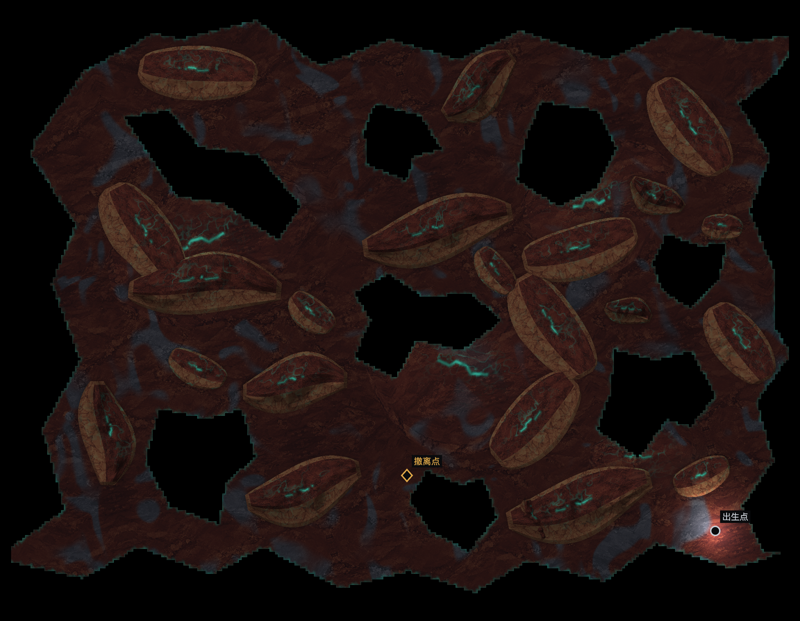

# 余烬脊实体减量（2026-10-11）

用户原话：“空洞数量 pass，障碍物太多了，减少约 30”。按已告知用户的约30%处理，仅调整余烬脊；空洞数量获局部认可，不扩大为整体地图或全库通过。关联 COH-F007/F011/F012/F013/F014，DEC-200。

## 改动

32件阻行实体减至22件（-31.25%）。删除作者ID 10、12、22、25、29、32、36、38、39、41；清掉主脊周围及北/西南的冗余中型实体，保留3条主脊、11件中型和8件短碎块。保留实例的ID、source_index、位置、尺寸、旋转均未修改。

8处内部VOID、外岸、出生候选、4处可走低床保持原作者数据。普通实体仍只阻行/近战，VOID继续阻行及阻视线。改动只有作者CSV→生成产物，无运行时、系统规则、架构或UI变化；不需要另立spec。新出发采用新布局，已有冻结配方保持原样。其余107世界不变，仍待后续整改。

## 本次验证

- [精确保留核对](artifacts/r100-obstacle-reduction-2026-10-11/preservation.json)：相对b8bd2667仅删除10条实体行，保留行和其他空间CSV字节一致；[107世界范围](artifacts/r100-obstacle-reduction-2026-10-11/scope.json)通过。
- [完整生成](artifacts/r100-obstacle-reduction-2026-10-11/production.json)：low 第2候选，可达100.000%；medium 第3候选，可达99.988%；severe 第4候选，可达98.826%。配额、20px身体/8px支撑、巡逻窗、至少两组双侧绕行与探索式撤离通过。实体占地/有地面积从约39.52%降至29.07%，数量减量和占地减量分别计。
- [实际生产浏览器](artifacts/r100-obstacle-reduction-2026-10-11/browser/capture.json)：中档请求种子20261010，第3候选651732515生成成功；去雾图直接复制实际RiftScene材质层，几何c250a3ea，2304×1792。入场撤离点未知且不可见，零页面错误。源代码/data固定于同目录source-snapshot.json。
- [旧配方复验](artifacts/r100-obstacle-reduction-2026-10-11/frozen.json)：上一版32实体的实际浏览器配方精确保持原几何、出生及撤离，不追改已在途的地图。
- spatial/package codegen check、[构建](artifacts/r100-obstacle-reduction-2026-10-11/build.log)通过，保留既有大chunk提示。未改运行时代码；本次未重跑性能长测或普通视野旅程，不将上轮测试计成本轮新增覆盖。
- [美术窄复核](artifacts/r100-obstacle-reduction-2026-10-11/art-review.md)：只判断本次减量和大小层次，用户仍可复看实体密度。几何圆梭族与边缘小齿的既有限制不因减量宣称消除。

本次是余烬脊单世界密度调整；不扩为全种子、自然探索或108世界验收。R100仍13/14，I14/P49不变。现状索引登记人审局部结论E217与当前限定结果E218，历史证据保留。

现状索引已刷新；结构检查0错误、0未登记文件，2条既有告警与957条来源漂移继续保留，未用整体baseline清除历史证据差异。详见[索引检查](artifacts/r100-obstacle-reduction-2026-10-11/state-final-check.json)。
