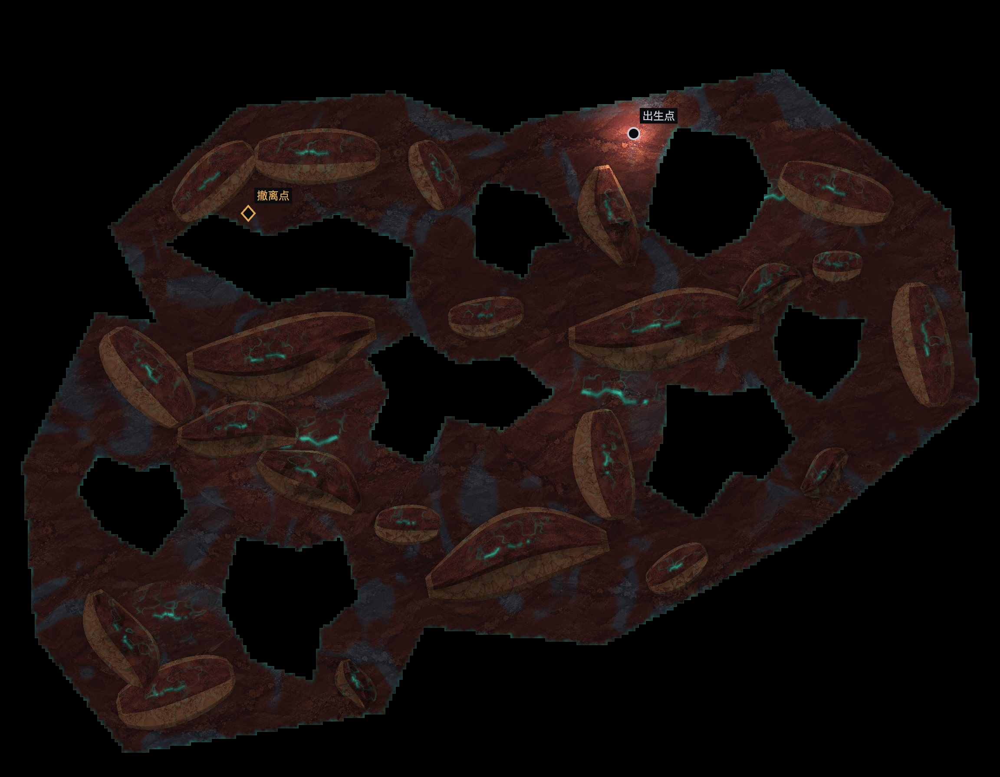

# 正向地床：余烬脊代表返修（2026-10-11）

用户否决3e0821a7：整体仍是近矩形，多轮都有同一问题，底层生成意图错误。本轮绑定COH-F007/F011/F012/F013/F014，复核F006/F039/F044/F052依赖；DEC-201。8孔数量的局部认可保留，不把技术通过或本轮AI图审升为用户验收。仅余烬脊启用，其他107待整改。

## 根因与实际改动

旧createMasterWorld固定先铺内缩矩形，作者sector-cuts再按上/右/下/左切条；DEC-199浅岸处方保住了矩形骨架。此前关于不对称掉角的判断没有回答整体轮廓问题。

新增正向CSV板片 → 精确联合的单外环 → 冻结spatialPolicy.terrainOutline。新路径直接在8px格中心生成有地，再减8内部孔；32px材料采样从细网格派生，外岸边色和断沿读取同一地形。recipe.nativeDefinition仍是原尺寸构造母版，禁止第二份outline；空间展开后的MasterDefinition才带新环。无字段保持旧路径和旧身份，不追改在途局。

首稿板片虽摆脱贴框矩形，却仍像围中心补齐的厚盘，内部图审退回。[宏形记录](artifacts/r100-positive-ground-2026-10-11/macro-studies/README.md)保留失败。现3片为东北较长厚腹、西南错位宽脚、西北短肩，东南整片缺席，联合成17点单环；8孔/22实体/4低床/8出生候选随地床重排。三主脊和8短碎块保持尺寸，11中件有差别地收量，避免地床收拢后重新过挤。作者阶段只改变地面与位置/平面尺寸，原材料与实例构造保留。

地床净面积约48.709%画布；实际准入种子的实体占有地约31.8–31.9%，比前一版29.1%稍密，低于被要求减量前39.5%。这些是诊断，不是轮廓验收门。不得用数字代替“是否仍是削角/旋转矩形、厚盘或地洞”的实际图判断。

## 已取得证据

- [正向合同检查](artifacts/r100-positive-ground-2026-10-11/contract.json)：3072个8px格、46个跨32px边界格、8内部孔、非法外环/孔越岸/双源拒绝、真实v4地沿材质与worker恢复；2个无outline夹具对3e原实现的完整transferable world及field逐值一致。
- [独立QA](artifacts/r100-positive-ground-2026-10-11/qa-review.md)：凹环中孔顶点在内但边跨凹口、touch外岸均拒绝；最终surface bake的alpha和独立8px支撑逐像素一致。首次错查fixture profile、第二次把中间底图alpha误认最终alpha的失败保留，修正正常调用后通过，不是生产错误。
- [请求种子20261010](artifacts/r100-positive-ground-2026-10-11/production-initial.json)：低/中/重分别第8/4/4候选成功；[额外种子20261011](artifacts/r100-positive-ground-2026-10-11/production-second-seed.json)为第2/4/6候选。6例完整配额、巡逻、身体连通、两组双侧绕行及探索式撤离通过；最小身体可达99.742%。低档接近8候选上限，如实保留；不推断全种子拒绝率。
- [实际生产浏览器](artifacts/r100-positive-ground-2026-10-11/browser-initial/capture.json)：中档请求20261010 → 第4候选114481409，几何3af97183，2304×1792。全图复制真实RiftScene接收面；入场出口未知且不可见、无页面错误。源绑定同目录source-snapshot.json。
- [旧3个r7配方](artifacts/r100-positive-ground-2026-10-11/frozen-legacy.json)与历史记录逐值对比layout/raster/identity；[上轮22实体实际配方](artifacts/r100-positive-ground-2026-10-11/frozen-previous.json)保持几何、出生与撤离。后者不是浏览器冷续测试。
- [107世界范围](artifacts/r100-positive-ground-2026-10-11/scope.json)通过；源数据只对余烬脊换作者输入。spatial/package/岸形union生成检查及[构建](artifacts/r100-positive-ground-2026-10-11/build.log)通过，保留已有大chunk提示。
- [离线实际视线](artifacts/r100-positive-ground-2026-10-11/sight.json)：3处独立内部VOID见证，实际当前视距与完整身体绕路成立。[同一孔的普通输入往返](artifacts/r100-positive-ground-2026-10-11/sight-browser-fixed/report.json)实际0→1→0，三站移除遮蔽反事实均为1，HP100，游戏计时22.816秒。返回采样位与首次隐藏位不同（朝向按键也会移动），只证明回到遮挡侧再次不可见，非完全同点复测；此为预读地图的诊断导航，非自然搜撤。
- [原往返失败](artifacts/r100-positive-ground-2026-10-11/sight-browser/report.json)保留：返回沿边站位对真实三角形碰撞合法、对保守导航格不合法，旧BFS仅访问1格，见[原坐标复核](artifacts/r100-positive-ground-2026-10-11/navigation-start-probe.json)。只修测试工具入口，以真实20px身体完整扫掠接入32px范围内可走格心；未传送角色或放宽生产碰撞。重跑实际触发该分支，接入距离26.892px、扫掠比例1，随后按原网格往返通过。
- [重档运行预算](artifacts/r100-positive-ground-2026-10-11/runtime/report.json)：固定请求种子20261004、普通按键移动64.081秒，角色存活；3844帧，帧间隔p95 17.4ms、主循环CPU p95 4.6ms，>50ms帧0。Apple M4 Pro共享参考机、隔离浏览器profile关闭节能；没有独占机器、GPU显存、全世界或低配设备保证。
- [最终源一致性](artifacts/r100-positive-ground-2026-10-11/final-source-match.json)：当前760个源文件与实际浏览器冻结快照逐文件一致。

## 实际图复核

[独立美术单次实图复核](artifacts/r100-positive-ground-2026-10-11/art-review-final.md)认为：当前整体已不以近矩形、厚盘或洞穴窄颈房间为主导；西南宽脚与东北主体偏置，北缘/西缘凹失和东南大片缺席改变了宏形，中央仍有宽地面联结，可交用户复看。保留风险：右下和左上的长斜岸偏整齐，孔边台阶精度接近，仍有“完整板块打孔”的余味。该结论仅为AI实图判断，不能代替用户轮廓/审美认可。

## 当前边界

算法正向表示、技术检查、AI实际图判断和人审分别记录。未做全库/全种子推广、完整自然搜撤或长期经济；本次只处理代表的大轮廓生成方式，I14/P49仍开放。没有改UI、输入或收益规则；地图唯一spec原地更新，架构记录新增数据流，无新增生产模块。

状态索引按新增证据刷新，结构诊断归[state-final-check.json](artifacts/r100-positive-ground-2026-10-11/state-final-check.json)。本轮不盲刷全项目旧来源基线，历史来源漂移仍单独保留；不把结构校验当玩法或美术验收。
